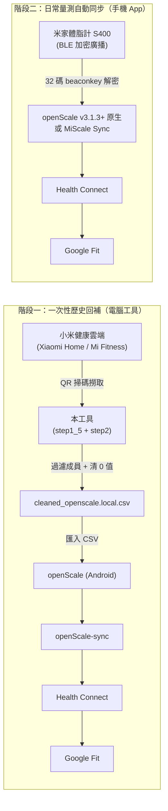

# 米家體脂計 S400 同步至 Android Health Connect / Google Fit 完整教學與工具

將 **Xiaomi 體脂計 S400**（型號 `MJTZC01YM` / MIoT `yunmai.scales.ms104` / `ms103`）的**歷史紀錄**與**日常量測**完整串接到 Android **Health Connect** 與 **Google Fit**。

---

## 為什麼需要這個工具？

1. **米家 App 封閉限制**：S400 綁定於「米家 (Xiaomi Home)」App，官方未提供直連 Google Fit / Health Connect 的同步選項，也沒有批次匯出歷史 CSV 的按鈕。
2. **藍牙加密門檻**：與舊款 Mi Scale 2 明文廣播不同，S400 的藍牙封包（MiBeacon `0xFE95`）全面加密，第三方 App 必須填入 **32 碼 BLE `beaconkey`**（或 24 碼 `token`）才能解密讀取。
3. **Google 生態系改版**：舊版 Google Fit REST API 將於 2026 年底退場，現階段正確架構是寫入 Android 系統內建的 **Health Connect（健康資料存取）**，再由 **Google Fit App** 自動讀取顯示。

### 專案特色

- **零外部套件依賴**：純 Node.js（`>= 20.0.0`）ESM 實作，**不需 Python、不需 `npm install`**。
- **純 JS RC4-Drop[1024]**：解決 Node.js v20+ / v26（OpenSSL 3）移除內建 RC4 的問題。
- **QR Code 掃碼登入**：使用米家 App 掃碼授權，免輸入帳號密碼，避開 2FA 與驗證碼迴圈。
- **完整歷史撈取 + 清洗**：從小米健康雲端抓回所有歷史體組成數據（體重、體脂率、肌肉量、去脂體重、骨骼肌、水分、骨量、內臟脂肪、BMR、心率），自動支援**多家庭成員過濾**與**穿襪量測 `0` 值清洗**，輸出符合 `openScale` 原生格式的 CSV。

---

## 整體資料流架構



---

## 事前準備

### 電腦端
- **Node.js `v20.0.0` 以上**（已在 Node.js `v26.13.1` 實測通過）。

### 手機端（Android）
- **米家 (Xiaomi Home) App**：確認 S400 已配對綁定在你的帳號下。
- **openScale**（**v3.1.3 以上**，原生支援 S400）：[GitHub Releases](https://github.com/oliexdev/openScale/releases) / Google Play / F-Droid。
- **openScale-sync**（**v0.6.3 以上**，支援寫入 Health Connect）：[GitHub Releases](https://github.com/oliexdev/openScale-sync/releases) / Google Play / F-Droid。
- *(可選替代)* **[MiScale Sync](https://play.google.com/store/apps/details?id=com.bongiocoder.miscalesync)**（Google Play 單一 App，若只做日常單人同步可直接寫入 Health Connect）。

---

## 完整實戰步驟

### Step 1：QR Code 登入，取得 MAC 與 32 碼 `beaconkey`

在專案根目錄執行：

```bash
node step1_explore.mjs
```

1. 程式會下載登入用 QR Code 並儲存為 `qr.png`（Windows 會嘗試自動開啟圖片，終端機也會印出備用網址）。
2. 打開手機 **米家 App → 掃一掃** 掃描確認登入。
3. 程式預設依序掃描 `tw`、`sg`、`cn` 區域（若帳號在其他區可加 `--region all`）。

> **台灣 (`tw`) 帳號常見狀況**：小米亞太區伺服器共用資料庫，`tw` 與 `sg` 可能會回傳同一台 `did` 而提示偵測到 2 個裝置。這時直接指定 `tw` 並重用剛才的登入 Session（免重掃 QR Code）即可：
> ```bash
> node step1_explore.mjs --reuse-session --region tw
> ```

成功後會在本機產生 `output/s400_credentials.local.json`（已設定 `.gitignore`，不會上傳）。可用以下指令單獨印出設定手機 App 所需的兩行值：

```bash
node -e "const c=require('./output/s400_credentials.local.json'); console.log('MAC      :', c.mac); console.log('BEACONKEY:', c.beaconkey, '(len=' + c.beaconkey.length + ')');"
```

---

### Step 2：抓取小米雲端全部歷史體重與體組成

接續重用 `.session.json` 執行歷史擷取（自動偵測 `xiaomihome` 與 `mifitness` 雲端端點並分頁抓完所有資料）：

```bash
node step1_5_history.mjs --reuse-session
```

執行完成後會在 `output/` 產生：
- `history_records.local.json`：正規化後的完整歷史紀錄（時間、體重、體脂、肌肉量、去脂體重、骨骼肌、水分、骨量、內臟脂肪、BMR、心率、雙頻阻抗）。
- `history_records.local.csv`：可用 Excel 開啟檢視的 UTF-8 CSV。
- `history_summary.json`：遮罩帳號/裝置識別碼的統計摘要。

---

### Step 3：過濾家庭成員與清洗無效 `0` 值

在寫入 Health Connect / openScale 前，通常需要處理兩個資料問題：
1. **多成員混合**：家中若有兩人以上使用同台體脂計，雲端紀錄會混在一起，需依成員拆開。
2. **穿襪／不完整量測的 `0` 值**：穿襪上秤或提早下秤時，小米會把體脂、肌肉、心率等記為 `0`，直接匯入會污染圖表或觸發驗證錯誤。

先列出偵測到的成員清單與體重區間：

```bash
node step2_clean_history.mjs --list-members
```

範例輸出：

```text
偵測到的家庭成員清單：
  [1] member="MemberA" | 筆數=120 | 體重範圍=68.2～72.4 kg (平均 70.5 kg) | 日期=2026-04-21 ～ 2026-11-23
  [2] member="MemberB" | 筆數=64  | 體重範圍=50.1～53.8 kg (平均 52.0 kg) | 日期=2026-04-22 ～ 2026-11-20
```

確認自己的編號後執行清洗（例如編號 `1`）：

```bash
node step2_clean_history.mjs --member-index 1
```

清洗工具會自動：
- 只保留該成員的紀錄，依時間排序並去除重複項目。
- 將次要指標的無效 `0` 值轉為空值（在 openScale CSV 中依其原生浮點數解析規則填入 `0.0`，確保匯入不報錯且保留該筆體重）。
- 輸出 `output/cleaned_openscale.local.csv`（及 `output/cleaned_health_connect.local.json`）。

---

### Step 4：匯入歷史資料進 Android（openScale → Health Connect → Google Fit）

1. 將 `output/cleaned_openscale.local.csv` 傳到手機的 `Download` 資料夾（透過 USB、Google Drive 等方式）。
2. 在手機打開 **openScale**，建立自己的使用者檔案（身高、生日、性別）。
3. 進入 **openScale → 設定 → 備份與匯入（或資料）→ 匯入 CSV**，選擇 `cleaned_openscale.local.csv` 完成匯入。
4. 打開 **openScale-sync**：
   - 連結你的 openScale 使用者與系統的 **Health Connect（健康資料存取）**。
   - 授予體重、體脂、去脂體重等寫入權限並執行同步，歷史資料就會寫入 Health Connect。
5. 打開 **Google Fit App → 個人資料 → 設定**：
   - 開啟 **「將 Fit 與健康資料存取 (Health Connect) 同步」**。
   - 前往 **瀏覽 → 身體測量**，等待數十秒下拉更新即可看到完整歷史曲線。

---

### Step 5：設定日常自動同步（二選一）

歷史補齊後，日常上秤有兩種推薦接法：

#### 方式 A：直接用 `openScale v3.1.3+` 原生連 S400（推薦，免費開源 + 支援多人）
1. 打開 **openScale → 設定 → 藍牙**，搜尋並選取你的 **Xiaomi S400**（`MiScaleS400Handler`）。
2. 在 S400 驅動設定欄位貼入 Step 1 取得的 **32 碼 `beaconkey`**。
3. 之後只要打開 openScale 點擊藍牙連線並赤腳站上體脂計，數值就會自動解密、依體重區間歸給對應成員，再經由 `openScale-sync` 自動推送至 Health Connect / Google Fit。

#### 方式 B：改用 `MiScale Sync`（單一 App、操作極簡）
1. 若歷史已透過 Step 4 灌進 Health Connect，日常只想留一個 App，可在 Google Play 安裝 **MiScale Sync**。
2. 在 App 內填好個人身高/年齡、選擇 Xiaomi S400 並貼入 **32 碼 `beaconkey`**。
3. 開啟 Auto Upload 至 Health Connect 即可（注意：若改用 MiScale Sync 同步，請將 `openScale-sync` 的 Health Connect 同步關閉，避免寫入重複紀錄）。

---

## 常見踩坑與 FAQ

<details>
<summary><b>1. openScale 和 MiScale Sync 可以同時裝嗎？會不會衝突？</b></summary>

- **藍牙不會衝突**：兩者都是用 32 碼 `beaconkey` 解密 S400 的 **BLE 被動廣播**，不會獨佔連線，也不會和米家 App 互搶。
- **Health Connect 資料會重複**：若兩邊同時開啟寫入 Health Connect，每量一次就會寫入兩筆相同時間點的紀錄。**請只保留其中一條寫入通道**（`openScale-sync` 或 `MiScale Sync` 二選一）。
</details>

<details>
<summary><b>2. 我可以移除米家裡的 S400 或按背面重置鍵嗎？</b></summary>

**千萬不要恢復原廠設定或在米家解除綁定！** 一旦重置或重新配對，S400 的 `beaconkey` 與 `token` 都會重新產生，原本設定在手機 App 的金鑰會立刻失效，必須重新跑一次 Step 1。
</details>

<details>
<summary><b>3. 家裡有多個人要用怎麼辦？</b></summary>

- **用 openScale**：同一支手機可建多位使用者，openScale 會依「最接近誰的歷史體重」自動分配紀錄；另一位家人若也要同步到他自己的 Google Fit，在他自己的手機安裝 App 並使用**同一組 32 碼 `beaconkey`** 即可，也可執行 `node step2_clean_history.mjs --member-index 2` 匯出他的歷史 CSV。
- **用 MiScale Sync**：該 App 為單人設定，建議兩位家人各自在自己的手機安裝並設定自己的身高/年齡（共用同一組 `beaconkey`），並視需要關閉自動上傳改為手動確認，避免誤收另一半的體重。
</details>

<details>
<summary><b>4. 為什麼 Google Fit 看不到「肌肉量」曲線？</b></summary>

Google Fit App 介面本身偏精簡，通常只展示體重與體脂率；但去脂體重（`LeanBodyMassRecord`）確實已寫入系統的 **Health Connect**。你可以到 Android **設定 → 健康資料存取 → 資料和存取權 → 身體測量** 確認所有欄位皆有完整紀錄。
</details>

<details>
<summary><b>5. 為什麼本地 App 算出來的體脂率跟米家 App 差了 1%～3%？</b></summary>

S400 廣播的是原始體重與雙頻生物阻抗（50kHz / 250kHz）。米家 App 使用的是小米／雲麥雲端私有演算法；而 openScale / MiScale Sync 是在手機端以公開 BIA 公式換算，因此體重完全一致，體脂率與肌肉量會有些微落差，屬正常現象。
</details>

<details>
<summary><b>6. Windows PowerShell 執行 `npm test` 出現權限錯誤怎麼辦？</b></summary>

若系統停用 `.ps1` 腳本執行原則導致 `npm.ps1` 報錯，改用以下任一指令執行單元測試即可：

```powershell
node --test
# 或
npm.cmd test
```
</details>

---

## 隱私與安全說明

- 本專案已透過 [.gitignore](.gitignore) 忽略 `output/`、`.session*.json`、`qr*.png` 等所有含憑證或個人體重數據的檔案。
- 如果你要 fork 或上傳到自己的公開 GitHub Repo，**請勿手動強制 `git add -f output/`**，以免將自己的 `beaconkey`、Token 或體重紀錄推上公開網路。

## 專案架構

```text
xiaomi-s400-sync/
├── step1_explore.mjs         # Step 1: QR 登入 + 取得 MAC / 24碼 token / 32碼 beaconkey + MIoT-Spec 探勘
├── step1_5_history.mjs       # Step 1.5: 小米雲端體組成歷史抓取（支援 xiaomihome / mifitness）
├── step2_clean_history.mjs   # Step 2: 家庭成員過濾 + 0 值清洗 + openScale CSV / HC JSON 匯出
├── src/
│   ├── xiaomi_crypto.mjs     # 純 JS RC4-Drop[1024] 與 MiOT HMAC/SHA1 簽章
│   ├── xiaomi_cloud.mjs      # 小米帳號 QR Long-Polling 登入與加密 API 用戶端
│   ├── miot_probe.mjs        # MIoT-Spec 查詢與雲端歷史欄位探勘器
│   ├── xiaomi_health.mjs     # 小米健康雲（fromSource 1/2/3 & Mi Fitness）解析器
│   └── history_cleaner.mjs   # 成員分組、0 值清洗、openScale CSV 格式化
└── test/
    ├── crypto.test.mjs       # 加密與簽章單元測試
    ├── health_parser.test.mjs# 雲端歷史解析與去重單元測試
    └── history_cleaner.test.mjs # 清洗與 CSV 格式單元測試
```

## 致謝

本工具的協議實作與相容設計參考了以下優秀的開源專案：
- [PiotrMachowski/Xiaomi-cloud-tokens-extractor](https://github.com/PiotrMachowski/Xiaomi-cloud-tokens-extractor)（QR 登入與 MiOT Token / Beaconkey 協議）
- [AlexxIT/SmartScaleConnect](https://github.com/AlexxIT/SmartScaleConnect)（小米雲端體脂計歷史端點與 `fromSource` 格式解析）
- [oliexdev/openScale](https://github.com/oliexdev/openScale) & [openScale-sync](https://github.com/oliexdev/openScale-sync)（Android 本地體組成追蹤與 Health Connect 同步）
